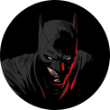
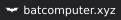
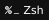

### Nick Escobar (nickesc)

###### _Frontend Developer @ Waybetter Marketing_

Hi, I'm Nick!

I'm a web developer and designer, and I'm passionate about open-source and building tools that help people. Sometimes I make games.

Creator of [_N. Escobar Media_](https://nescobar.media), an independent studio that builds software and helps small teams and individuals resolve technical problems.

 

 

  
<h3>More about me</h3>

I'm a graduate of Occidental College, a small liberal arts college in Los Angeles, with a B.A. in Computer Science and minors in Studio Art and Media Studies.

I've been coding since high school, and I've been working as a professional web developer since 2023.

I love video games -- making, collecting, playing, everything. Ask me about them!

Almost everything I make is open-source, and I'm excited to contribute to the community.

I believe in building software that empowers users, encourages thoughtful engagement, and prioritizes privacy.

  
<h3>Work with me</h3>

I'm open to collaborating on open-source tools, apps, and other creative projects.

The best ways to reach me:

- For repository-specific questions or bugs: open an issue on the relevant repo
- For everything else: reach out on [my website](https://nickesc.io/contact)

  
<h3>Where to find my work</h3>

<blockquote>
<dl>
<dt>Code, Apps & Packages</dt>
<dd>

</dd>
</dl>

<dl>
<dt>Extensions & Add-ons</dt>
<dd>

</dd>
</dl>

<dl>
<dt>Games</dt>
<dd>

</dd>
</dl>
</blockquote>

  
<h3>Where to follow me</h3>

